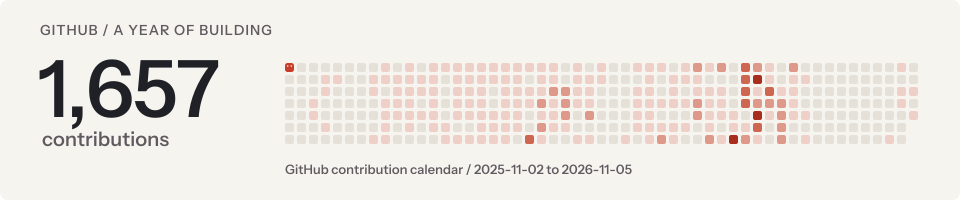

<picture>
  <source media="(prefers-color-scheme: dark)" srcset="assets/header-dark.svg">
  
</picture>

Full-stack developer in **Ottawa**. I build web platforms, mobile apps and the systems behind them. **Available for Summer 2027 co-op.**

**[Portfolio ↗](https://moeabdulla.com)** · **[Résumé ↗](https://moeabdulla.com/Resume.pdf)** · [LinkedIn](https://www.linkedin.com/in/mohammed-s-abdulla/) · [Email](mailto:moe.s.abdulla@gmail.com)

## A few things I’ve shipped

Click a project for the story.

<a href="https://moeabdulla.com/work/promote">
<picture>
  <source media="(prefers-color-scheme: dark)" srcset="assets/promote-dark.svg">
  
</picture>
</a>

<a href="https://moeabdulla.com/work/shredder">
<picture>
  <source media="(prefers-color-scheme: dark)" srcset="assets/shredder-dark.svg">
  
</picture>
</a>

<a href="https://moeabdulla.com/work/iuoc">
<picture>
  <source media="(prefers-color-scheme: dark)" srcset="assets/iuoc-dark.svg">
  
</picture>
</a>

<a href="https://moeabdulla.com/#search-work">
<picture>
  <source media="(prefers-color-scheme: dark)" srcset="assets/dfo-dark.svg">
  
</picture>
</a>

## Between releases

<picture>
  <source media="(prefers-color-scheme: dark)" srcset="assets/activity-dark.svg">
  
</picture>

<a href="https://moeabdulla.com/work/pengu-focus">
<picture>
  <source media="(prefers-color-scheme: dark)" srcset="assets/pengu-dark.svg">
  
</picture>
</a>

Also built: [Zums](https://moeabdulla.com/work/zums) · [Billhead](https://moeabdulla.com/work/billhead) · [Holdfast](https://moeabdulla.com/work/holdfast)

Most client code is private. Explore [Space Showcase](https://github.com/moeabdulla/SpaceShowcase) or my [Expo template](https://github.com/moeabdulla/Expo-Template).

---

Have a co-op role or a product to build? **[Let’s talk.](mailto:moe.s.abdulla@gmail.com)**
